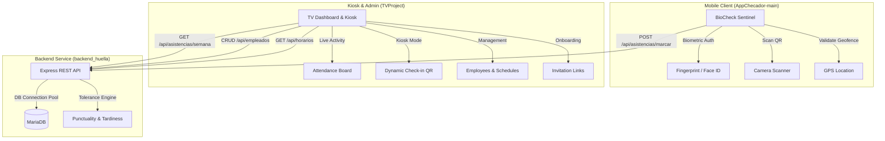

# BioCheck Sentinel & Attendance Management Ecosystem

A multi-platform attendance tracking and biometric access control ecosystem consisting of an employee mobile app, a Smart TV access kiosk & administrative dashboard, and a centralized REST API backend.

---

## 📐 System Architecture



---

## 📁 Repository Structure

```text
.
├── AppChecador-main/     # Mobile application for employees (Expo SDK 57, React Native 0.86)
├── TVProject/            # Smart TV kiosk & admin board (React Native TV OS, Expo SDK 57)
├── backend_huella/       # REST API service & database layer (Node.js, Express, MariaDB)
├── .gitignore            # Global repository ignore rules
└── README.md             # Project documentation
```

---

## 🧩 Components Overview

### 1. [AppChecador-main](file:///home/anon/uni/cua9/movil/p1/afinal/AppChecador-main) (Employee Mobile App)

Mobile application enabling employees to record their attendance with multi-factor verification:
- **Biometric Security**: Biometric validation (TouchID, FaceID, Fingerprint) using `expo-local-authentication`.
- **Optical Validation**: Access terminal scanning via `expo-camera`.
- **Geofencing**: Location checks against company coordinates via `expo-location`.
- **Modern UI**: Built with [NativeWind](https://www.nativewind.dev/) (Tailwind CSS v3) and [Expo Router](https://docs.expo.dev/router/introduction/).
- **Audio & Haptics**: Native haptic feedback and custom audio confirmation.

### 2. [TVProject](file:///home/anon/uni/cua9/movil/p1/afinal/TVProject) (TV Kiosk & Admin Dashboard)

Kiosk and administrative console built on the React Native TV OS fork:
- **TV Board / Kiosk View**: High-contrast, large-format kiosk view displaying dynamic QR codes for employee scanning and real-time check-in notifications.
- **Live Dashboard**: Daily metrics, active attendance counts, and recent entry/exit logs.
- **Employee Management**: Directory view, shift assignments, and employee activation/deactivation.
- **Onboarding Module**: Invitation generation and tokenized onboarding link creator.

### 3. [backend_huella](file:///home/anon/uni/cua9/movil/p1/afinal/backend_huella) (REST API & Persistence)

Centralized API handling business logic and attendance records:
- **Database Engine**: Connection pooling with MariaDB via `mariadb`.
- **Tolerance & Punctuality Engine**: Evaluates scheduled shift arrival time against actual check-in timestamps and grace periods (`tolerancia_minutos`).
- **REST Endpoints**: CRUD operations for employees, shift queries, and historical attendance reports.

---

## 🛠️ Prerequisites

- **Node.js**: v18.0.0 or higher (v20+ recommended)
- **Package Managers**: `npm` or `yarn`
- **Database**: [MariaDB](https://mariadb.org/) (or MySQL 8.0+)
- **Mobile & TV Development**:
  - [Expo CLI](https://docs.expo.dev/get-started/installation/) (`npx expo`)
  - [Expo Go](https://expo.dev/go) app (for mobile testing) or Android / iOS simulators
  - Android TV emulator or Apple TV simulator (for TV builds)

---

## 🚀 Getting Started

### 1. Database & Backend Setup

1. Navigate to the backend directory:
   ```bash
   cd backend_huella
   ```
2. Install dependencies:
   ```bash
   npm install
   ```
3. Configure environment variables:
   ```bash
   cp .env.example .env
   ```
   Update `.env` with your MariaDB database credentials:
   ```env
   DB_HOST=127.0.0.1
   DB_USER=root
   DB_PASSWORD=your_password
   DB_NAME=control_asistencias
   DB_PORT=3306
   PORT=3000
   ```
4. Prepare database tables:
   ```sql
   CREATE DATABASE IF NOT EXISTS control_asistencias;
   USE control_asistencias;

   CREATE TABLE IF NOT EXISTS horarios (
     id INT AUTO_INCREMENT PRIMARY KEY,
     nombre_turno VARCHAR(100) NOT NULL,
     hora_entrada TIME NOT NULL,
     tolerancia_minutos INT NOT NULL DEFAULT 10
   );

   CREATE TABLE IF NOT EXISTS empleados (
     id INT AUTO_INCREMENT PRIMARY KEY,
     nombre VARCHAR(100) NOT NULL,
     apellido VARCHAR(100) NOT NULL,
     foto_url VARCHAR(255),
     horario_id INT NOT NULL,
     estatus ENUM('Activo', 'Inactivo') DEFAULT 'Activo',
     FOREIGN KEY (horario_id) REFERENCES horarios(id)
   );

   CREATE TABLE IF NOT EXISTS asistencias (
     id INT AUTO_INCREMENT PRIMARY KEY,
     empleado_id INT NOT NULL,
     tipo ENUM('Entrada', 'Salida') NOT NULL,
     fecha_hora DATETIME NOT NULL,
     estado ENUM('A tiempo', 'Retardo') DEFAULT 'A tiempo',
     FOREIGN KEY (empleado_id) REFERENCES empleados(id)
   );
   ```
5. Start the backend development server:
   ```bash
   npm run dev
   ```
   The service will be listening on `http://localhost:3000`.

---

### 2. Mobile App Setup (AppChecador-main)

1. Navigate to the mobile app directory:
   ```bash
   cd AppChecador-main
   ```
2. Install dependencies:
   ```bash
   npm install
   ```
3. Set up environment configuration:
   ```bash
   cp .env.example .env
   ```
   Set `EXPO_PUBLIC_API_URL` to your backend instance:
   ```env
   EXPO_PUBLIC_API_URL=http://<YOUR_LOCAL_IP>:3000
   ```
4. Start the Expo development server:
   ```bash
   npx expo start
   ```
5. Scan the QR code using Expo Go (Android) or the Camera app (iOS).

---

### 3. TV Kiosk & Dashboard Setup (TVProject)

1. Navigate to the TV project directory:
   ```bash
   cd TVProject
   ```
2. Install dependencies:
   ```bash
   npm install
   ```
3. Run on your desired target:
   - **Web preview / Kiosk display**:
     ```bash
     npm run web
     ```
   - **Android TV**:
     ```bash
     npm run android
     ```
   - **Apple TV / iOS**:
     ```bash
     npm run ios
     ```
   - **Native TV prebuild**:
     ```bash
     npm run prebuild:tv
     ```

---

## 📡 API Endpoints Reference

| Method | Endpoint | Description |
|---|---|---|
| `GET` | `/api/empleados` | List all employees with assigned shift details |
| `POST` | `/api/empleados` | Create a new employee record |
| `PUT` | `/api/empleados/:id` | Update employee information or active status |
| `GET` | `/api/horarios` | List all available work shifts and schedules |
| `POST` | `/api/asistencias/marcar` | Record attendance check-in (`Entrada`) or check-out (`Salida`) |
| `GET` | `/api/asistencias/semana` | Retrieve weekly attendance history for TV display |

---

## 🔒 Security Best Practices

- Never commit `.env` files or sensitive credentials to source control. Use the provided [`.gitignore`](file:///home/anon/uni/cua9/movil/p1/afinal/.gitignore).
- Public Expo variables (`EXPO_PUBLIC_*`) are embedded in client bundles in plain text. Store private tokens and DB passwords exclusively in backend environment files.
- Keystores, signing certificates (`*.jks`, `*.p12`, `*.pem`), and build outputs (`/ios`, `/android`, `.expo/`) are excluded at the repository root.
